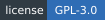

  

  
  
  
   
  
  
  

  <a href="README.md">English</a> / <strong>Русский</strong>

 — самостоятельное приложение для Windows с прозрачным окном поверх AION 2.
Собирайте свой интерфейс из иконок, полос и текста, задавайте триггеры и условия показа,
отслеживайте откаты, баффы и дебаффы, анализируйте урон, лечение и события боя.

Aurion получает данные из входящего игрового трафика, без чтения памяти игры и изменения её файлов.

## Возможности

<table width="100%">
  <tbody>
    <tr>
      <td width="30%"><strong>Редактор HUD</strong></td>
      <td width="70%">Иконки, полосы, текст, слои и группы.</td>
    </tr>
    <tr>
      <td width="30%"><strong>Умения и эффекты</strong></td>
      <td width="70%">Баффы, дебаффы, стаки, откаты, цепочки и касты.</td>
    </tr>
    <tr>
      <td width="30%"><strong>Триггеры</strong></td>
      <td width="70%">Что отслеживать и когда показывать элементы.</td>
    </tr>
    <tr>
      <td width="30%"><strong>Боевой журнал</strong></td>
      <td width="70%">DPS/HPS, история, графики, сравнение боёв и экспорт CSV.</td>
    </tr>
    <tr>
      <td width="30%"><strong>Профили</strong></td>
      <td width="70%">Импорт, экспорт, переводы и масштабирование под экран.</td>
    </tr>
  </tbody>
</table>

Поддержка группы экспериментальная. Подробнее — в [известных ограничениях](docs/ru/USAGE.md#известные-ограничения).

[Скриншоты: редактор, симуляция боя и разбор журнала →](docs/ru/screenshots.md)

## Установка

<strong>Требования:</strong> Windows 10/11 · <a href="https://npcap.com/#download">Npcap</a> · Microsoft Edge WebView2

[Скачать Aurion для Windows →](https://github.com/Oceangrace/Auiron/releases/latest)

1. Установите Npcap.
2. Распакуйте архив Aurion и запустите **aurion.exe**.
3. Запустите AION 2 и войдите в игровой мир. Данные появятся автоматически.
4. Откройте редактор из тулбара или системного трея. Создайте или импортируйте профиль и сохраните через <kbd>Ctrl</kbd> + <kbd>S</kbd>.

Если Aurion запущен, когда персонаж уже в мире, примените классовое умение:
приложение сможет определить класс и загрузить подходящие HUD. Если данные персонажа
остаются неполными, оставьте Aurion открытым и повторно войдите для получения полного начального снимка.

[Настройки Npcap, права доступа и управление →](docs/ru/USAGE.md)

## Пример профиля

**Клерик · Зеркальный HUD** — здоровье персонажа и цели, мана, умения, эффекты, рамки
группы и история применений. Собран в том же редакторе, который доступен каждому.

[Забрать профиль: импорт в Aurion, пресет интерфейса игры и примеры →](docs/ru/example.md)

## Нашли проблему или есть идея?

Если что-то не отображается, выглядит неправильно или перестало работать, сообщите нам
через вкладку **Issues** в репозитории. Особенно полезны сообщения о проблемах с примером
HUD клерика: они помогают улучшать и сам профиль, и Aurion.

Выберите форму ошибки или предложения на русском либо английском. Укажите версию Aurion,
что произошло и как это повторить. Для проблем с HUD очень помогут скриншот или короткое видео.

[Как сообщить о проблеме или предложить улучшение →](CONTRIBUTING.ru.md)

## Документация

<table width="100%">
  <thead>
    <tr>
      <th align="left" width="30%">Руководство</th>
      <th align="left" width="70%">Что внутри</th>
    </tr>
  </thead>
  <tbody>
    <tr>
      <td><a href="docs/ru/USAGE.md">Руководство</a></td>
      <td>Установка, настройки и горячие клавиши</td>
    </tr>
    <tr>
      <td><a href="docs/ru/DEVELOPMENT.md">Разработка</a></td>
      <td>Окружение, сборка, проверки и воспроизведение записей</td>
    </tr>
    <tr>
      <td><a href="docs/ru/PROTOCOL.md">Протокол</a></td>
      <td>Доступные игровые данные и ограничения парсера</td>
    </tr>
  </tbody>
</table>

## Лицензия

Aurion — свободная программа под [GNU General Public License v3.0](LICENSE) или любой более
поздней версией. У встроенных шрифтов свои лицензии: SIL Open Font License 1.1 и Ubuntu Font
Licence 1.0 для Ubuntu Sans. Тексты лицензий лежат рядом со шрифтами в `src/renderer/fonts/`.

Aurion — независимый фанатский проект, не связанный с NCSOFT и не одобренный ею.
AION 2, её названия и игровые материалы принадлежат правообладателям. Сторонние программы
могут противоречить правилам игры; используйте Aurion на свой риск.
