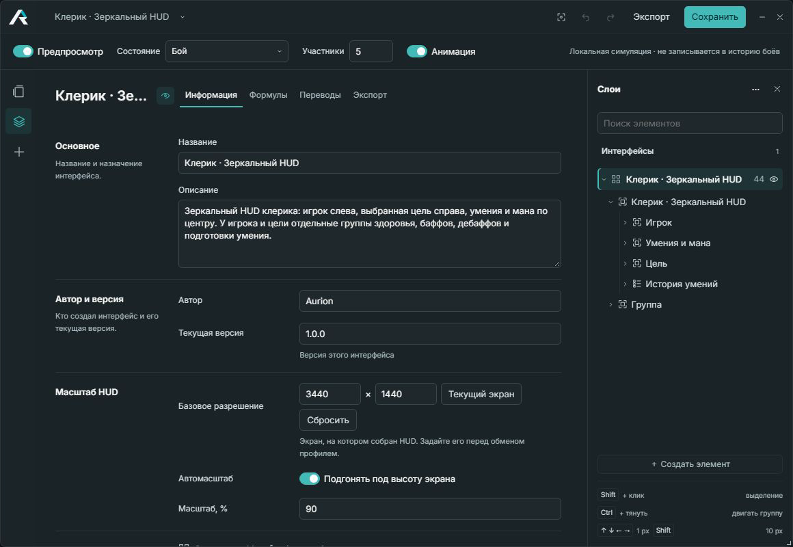
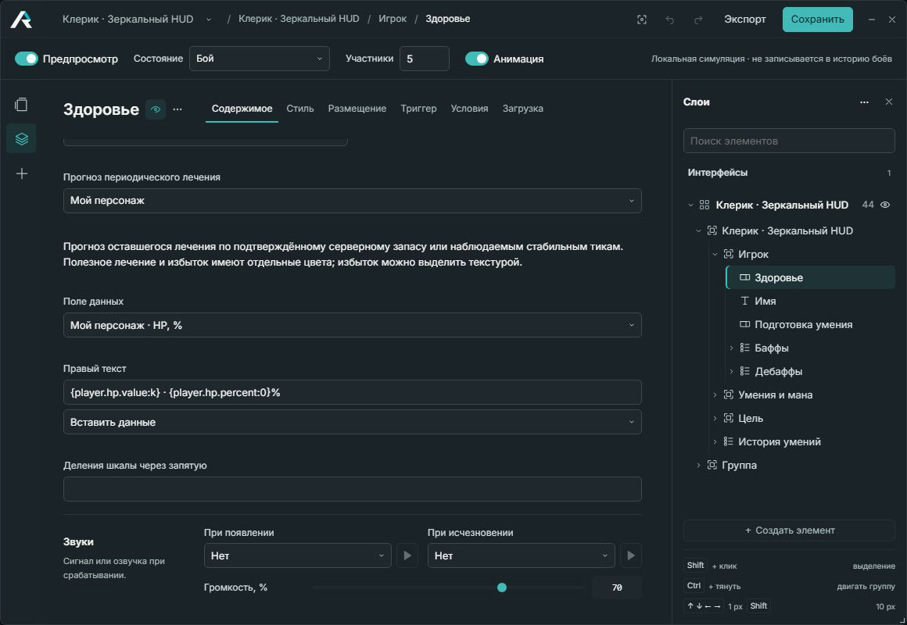
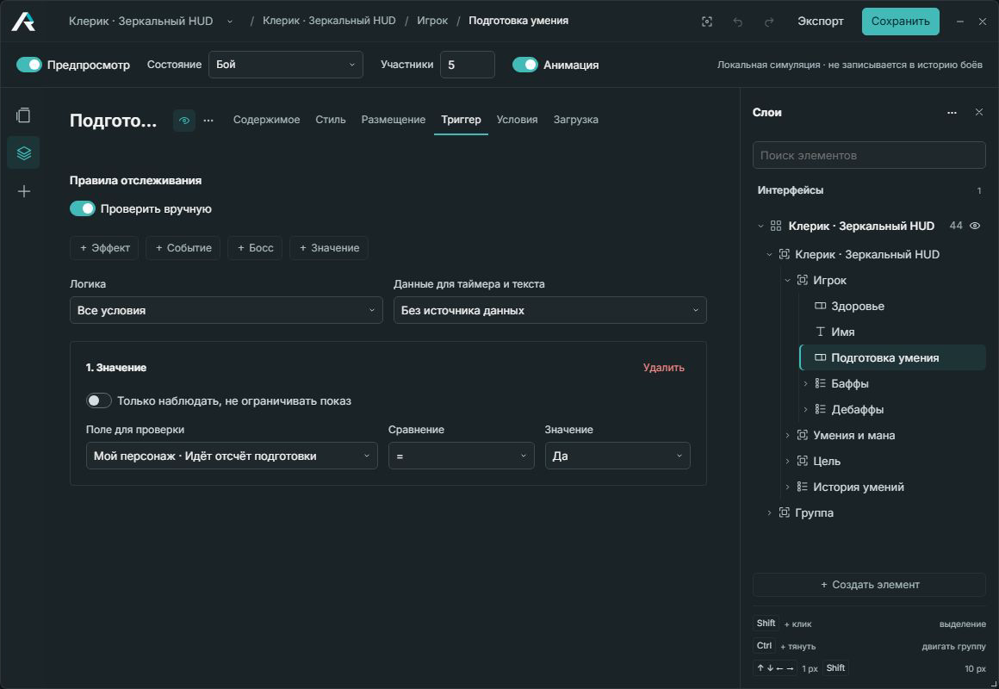
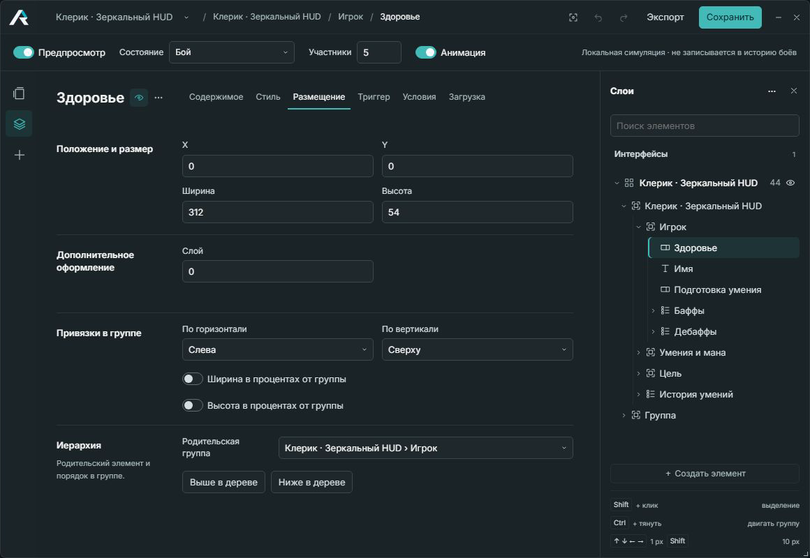
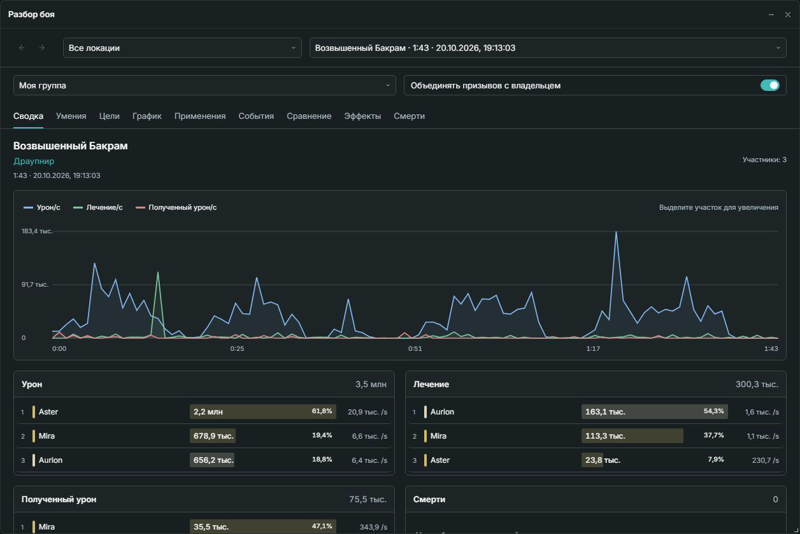
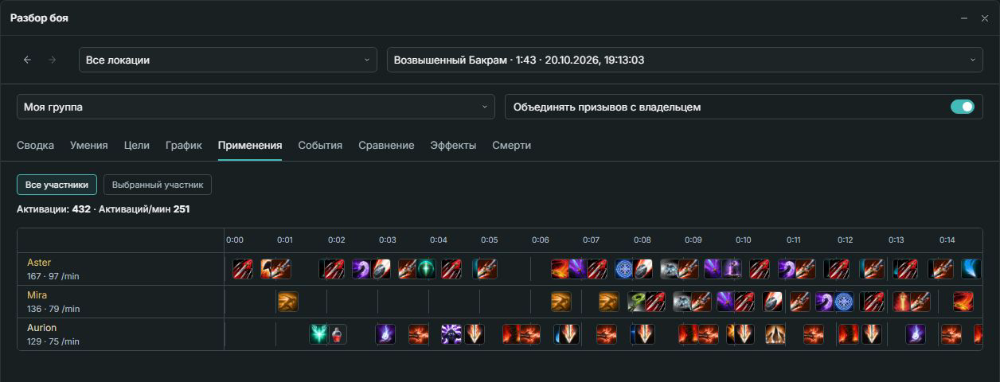

[← Aurion](../README.md) · **English** / [Русский](ru/screenshots.md)

# Inside Aurion

Click any screenshot to open it at full size. Journal examples use a saved fight with
player names replaced.

## Editor and combat simulation

Build a profile and preview health, healing, cooldowns, and party frames without entering
combat. The simulator runs locally and does not add fights to the journal.

## Health bars and healing forecasts

Bind a bar to game data, format its text, and enable periodic healing forecasts.

## Triggers

Choose the game fields, effects, or events that control each element. This cast bar appears
while the player's cast countdown is active.

## Placement and hierarchy

Set size, position, anchors, and the parent group for each HUD element.

## Fight overview

Damage, healing, damage taken, and the fight timeline in one view.

## Skill sequence

Compare the group's skill activations along a shared timeline, or focus on one participant.

For an importable profile and animated examples, see [Cleric · Mirrored HUD](example.md).
